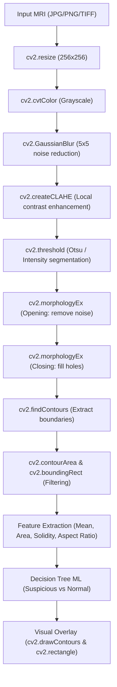
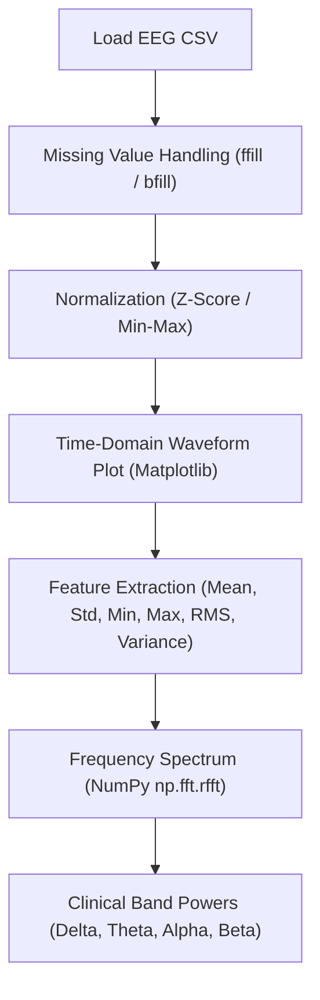

# Brain MRI & EEG Analysis for Brain Tumor — OpenCV + ML + Streamlit

**CIE-2 Digital Image and Video Processing Academic Project Prototype**

[](https://share.streamlit.io/deploy?repository=krishna237k/Brain-Tumor-MRI-and-EEG-Analysis&branch=main&mainModule=app.py)

---

## 📌 1. Project Overview & Goal

This project provides a compact, lightweight, and **line-by-line explainable academic prototype** for brain tumor candidate localization and neurological signal analysis. Designed specifically for a college-level **CIE-2 Digital Image and Video Processing (DIP)** examination and faculty demonstration, this system combines:

1. **Digital Image Processing (OpenCV):** An end-to-end computer vision pipeline that processes brain MRI scans to segment and localize suspicious hyperintense tumor candidate regions.
2. **Signal Processing (NumPy/Pandas):** An explainable EEG signal analysis module that cleans, standardizes, and computes both time-domain statistics and frequency-domain (FFT) features.
3. **Transparent Machine Learning (Scikit-Learn):** An explainable **Decision Tree Classifier** that classifies scans based on extracted geometrical and photometric features without opaque black-box deep learning.
4. **Interactive Web Interface (Streamlit):** An intuitive dashboard with interactive tuning parameters, step-by-step visual inspection, and built-in sample loaders.

> [!IMPORTANT]
> **Academic / Research Disclaimer:**  
> This application is an educational prototype developed strictly for academic demonstration and laboratory assessment. It is **NOT** a medical diagnostic device. Brain MRI image processing serves as the primary tumor-candidate localization method. **EEG analysis is supplementary and does not independently confirm or diagnose a brain tumor.**

---

## 🛠️ 2. Technology Stack

- **Language:** Python 3.10+
- **Image Processing:** OpenCV (`cv2`)
- **Signal & Numerical Computing:** NumPy, Pandas, SciPy
- **Data Visualization:** Matplotlib
- **Machine Learning:** Scikit-learn (Decision Trees)
- **Web App / UI:** Streamlit
- **Notebook Environment:** Jupyter Notebook (`.ipynb`)

*Note: In accordance with academic guidelines, no heavy deep learning frameworks (TensorFlow, PyTorch) or complex black-box architectures are used.*

---

## 📁 3. Project File Structure

```text
Brain Tumor/
│
├── app.py                             # Interactive Streamlit Web Application
├── Brain_Tumor_MRI_EEG_Analysis.ipynb  # Complete 13-stage Jupyter Notebook for CIE-2
├── mri_eeg_core.py                    # Modular core processing pipeline (OpenCV + EEG)
├── create_samples_and_model.py        # Dataset & Decision Tree model generator
├── requirements.txt                   # Dependency package manifest
├── README.md                          # Full academic documentation & viva guide
│
├── models/
│   └── model.pkl                      # Pre-trained Explainable Decision Tree classifier
│
└── sample_data/
    ├── sample_mri.png                 # Sample brain MRI slice with hyperintense tumor lesion
    ├── sample_mri_normal.png          # Sample healthy brain MRI slice without tumor
    └── sample_eeg.csv                 # 5-second 6-channel EEG CSV recording (256 Hz)
```

---

## 🔄 4. Processing Pipelines

### A. Brain MRI OpenCV Pipeline


### B. EEG Signal Analysis Pipeline


---

## 🔍 5. OpenCV Functions Explained Line-by-Line

Every OpenCV function used in this project maps directly to core Digital Image Processing syllabus topics:

1. **`cv2.imread(filepath)`**:
   - Reads image files into an 8-bit BGR NumPy array.
   - Supports JPG, JPEG, PNG, and TIFF formats.
2. **`cv2.resize(image, (256, 256))`**:
   - Standardizes spatial matrix resolution across heterogeneous scan sources, ensuring feature calculations are scale-consistent.
3. **`cv2.cvtColor(image, cv2.COLOR_BGR2GRAY)`**:
   - Converts 3-channel color data to 1-channel luminance using $Y = 0.299R + 0.587G + 0.114B$. Reduces memory and computational overhead by 66%.
4. **`cv2.GaussianBlur(gray, (5, 5), 0)`**:
   - Convolves the image with a 2D Gaussian kernel to attenuate high-frequency acquisition noise and thermal sensor artifacts.
5. **`cv2.createCLAHE(clipLimit=2.0, tileGridSize=(8, 8))`**:
   - Contrast Limited Adaptive Histogram Equalization. Divides the image into $8 \times 8$ contextual blocks and equalizes contrast locally while clipping gradient amplification to prevent noise explosion.
6. **`cv2.threshold(enhanced, threshold_val, 255, cv2.THRESH_BINARY)`**:
   - Binarizes grayscale intensity. In Otsu mode (`cv2.THRESH_OTSU`), it mathematically calculates the threshold $T$ that minimizes weighted intra-class variance $\sigma_w^2(T)$.
7. **`cv2.getStructuringElement(cv2.MORPH_RECT, (5, 5))`**:
   - Defines a flat, rectangular structural probing element for mathematical morphology.
8. **`cv2.morphologyEx(mask, cv2.MORPH_OPEN, kernel)`**:
   - **Opening ($\text{Erosion} \rightarrow \text{Dilation}$):** $\mathbf{A} \circ \mathbf{B} = (\mathbf{A} \ominus \mathbf{B}) \oplus \mathbf{B}$. Eliminates small isolated noise pixels and severs thin accidental bridges.
9. **`cv2.morphologyEx(mask, cv2.MORPH_CLOSE, kernel)`**:
   - **Closing ($\text{Dilation} \rightarrow \text{Erosion}$):** $\mathbf{A} \bullet \mathbf{B} = (\mathbf{A} \oplus \mathbf{B}) \ominus \mathbf{B}$. Fills small dark pinholes and crevices within the segmented lesion body.
10. **`cv2.findContours(morph, cv2.RETR_EXTERNAL, cv2.CHAIN_APPROX_SIMPLE)`**:
    - Traces the outer topological boundaries of connected components using Suzuki's border following algorithm.
11. **`cv2.contourArea(contour)`**:
    - Computes exact physical enclosed pixel area using Green's Theorem along the boundary polygon vertices.
12. **`cv2.boundingRect(contour)`**:
    - Calculates the axis-aligned bounding rectangle `[x, y, width, height]` enclosing the candidate.
13. **`cv2.drawContours(overlay, [contour], -1, (0, 0, 255), 2)`**:
    - Overlays the detected suspicious boundary in Red ($2\text{ px}$ stroke).
14. **`cv2.rectangle(overlay, (x, y), (x+w, y+h), (0, 255, 0), 2)`**:
    - Overlays the localization bounding box in Green ($2\text{ px}$ stroke).

---

## ⚡ 6. Installation & Execution Guide

### Step 1: Install Dependencies
Open a terminal in the project directory and run:
```bash
pip install -r requirements.txt
```

### Step 2: Run the Streamlit Web Application
Launch the interactive web interface:
```bash
streamlit run app.py
```
Streamlit will automatically open your default web browser at `http://localhost:8501`.

### Step 3: Run the Jupyter Notebook
Open the project folder in VS Code or JupyterLab and open:
```text
Brain_Tumor_MRI_EEG_Analysis.ipynb
```
Click **Run All Cells** to execute all 13 stages sequentially.

---

## 🖥️ 7. Faculty Demonstration Flow

When presenting this project to faculty during the CIE-2 examination:

1. **Start the Streamlit App:**
   - Run `streamlit run app.py`.
   - Point out the clean title, subtitle, and ethical medical disclaimer.
2. **Demonstrate Tumor Detection (Positive Case):**
   - Click the sidebar shortcut **"Tumor MRI"** (or upload `sample_data/sample_mri.png`).
   - Show the 5-stage visual progression:
     1. Original Resized (256x256)
     2. Preprocessed Grayscale + CLAHE
     3. Binary Segmentation Mask
     4. Morphological Result
     5. Detected Candidate Overlay (Red contour + Green bounding box)
   - Explain the quantitative metrics:
     - Candidate Area (e.g. $1582.5\text{ px}$), Area % ($2.41\%$), Mean Intensity ($238.4 / 255$).
   - Show the Decision Tree classification result: `Suspicious / Tumor Candidate (100% confidence)`.
3. **Demonstrate Healthy Scan (Negative Case):**
   - Click the sidebar shortcut **"Normal MRI"** (or upload `sample_data/sample_mri_normal.png`).
   - Show that the candidate area is $0.0\text{ px}$, and the system reports:
     - `Analysis Result: No Significant Suspicious Region Detected`
     - `ML Classification: Normal / Non-Tumor`.
4. **Demonstrate EEG Signal Analysis:**
   - Switch sidebar module to **"EEG Signal Analysis"**.
   - Click **"Load Built-in Sample EEG CSV"**.
   - Show the time-domain waveform and FFT spectrum for frontal (`Fp1` — Beta rhythm ~20 Hz) and posterior (`Pz` — Alpha rhythm ~10 Hz).
   - Read the ethical disclaimer: Explain that EEG measures brain rhythms and cannot independently diagnose a tumor.
5. **Open Faculty Viva Tab:**
   - Switch to **"Faculty Viva & Theory Guide"** in the sidebar to review the built-in technical FAQ.

---

## 🎓 8. Faculty Viva Questions & Answers (CIE-2 Ready)

### Q1: Why is Grayscale conversion necessary before thresholding?
> **Answer:** MRI scans record physical relaxation times ($T_1, T_2, \text{FLAIR}$), which represent scalar tissue densities rather than color. Converting from 3-channel RGB to 1-channel Grayscale discards redundant chrominance, reduces matrix operations by $66\%$, and simplifies segmentation to scalar intensity thresholding.

### Q2: Why use CLAHE over traditional Global Histogram Equalization?
> **Answer:** Global Histogram Equalization flattens the histogram across the entire image, which frequently over-amplifies background thermal noise and washes out subtle brain tissue interfaces. CLAHE operates on localized $8 \times 8$ tiles and clips histogram bin heights to a predefined limit (`clipLimit=2.0`), redistributing excess pixels uniformly to enhance local lesion contrast safely.

### Q3: What is Otsu's thresholding principle?
> **Answer:** Otsu's method is an exhaustive search algorithm that finds the threshold $T^*$ that maximizes the between-class variance $\sigma_b^2(T)$, which is mathematically equivalent to minimizing the weighted intra-class variance $\sigma_w^2(T) = \omega_0(T)\sigma_0^2(T) + \omega_1(T)\sigma_1^2(T)$.

### Q4: Why are Morphological Opening and Closing both applied?
> **Answer:**
> - **Opening ($\mathbf{A} \circ \mathbf{B}$):** Performs erosion followed by dilation with a $5 \times 5$ structuring element. It strips away isolated noise specks and severs thin accidental bridges to the skull ring.
> - **Closing ($\mathbf{A} \bullet \mathbf{B}$):** Performs dilation followed by erosion. It fills small dark holes and crevices within the candidate lesion body, consolidating it into a unified contour.

### Q5: Why was a Decision Tree chosen instead of a Deep Learning CNN?
> **Answer:**
> 1. **Complete Explainability:** A Decision Tree yields explicit if-else decision rules (e.g. $\text{mean\_intensity} > 162.7 \rightarrow \text{Suspicious}$). Every decision can be verified and justified.
> 2. **Pedagogical Alignment:** It links directly to the extracted Digital Image Processing features (Mean Intensity, Solidity, Area, Aspect Ratio).
> 3. **Resource Efficiency:** Runs in milliseconds on CPU with zero GPU dependencies.

### Q6: Can EEG signals detect brain tumors on their own?
> **Answer:** **No.** EEG records postsynaptic electrical potentials across cortical regions with high temporal resolution but poor spatial resolution. While a localized space-occupying tumor can produce non-specific slowing (focal polymorphic delta/theta waves) or epileptiform spikes due to compression, these electrophysiological patterns can also arise from stroke, trauma, or encephalitis. Therefore, MRI is the primary structural imaging tool, and EEG is supplementary.

---

## 📄 License & Attribution
Developed as an educational digital image and video processing prototype for CIE-2 academic assessment.

